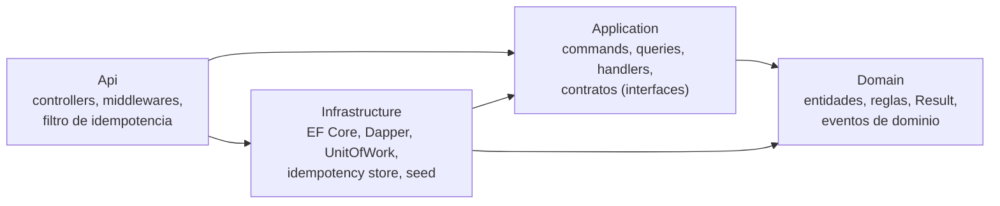
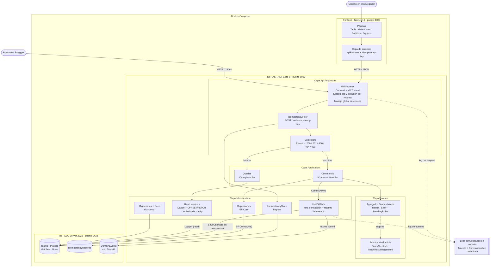
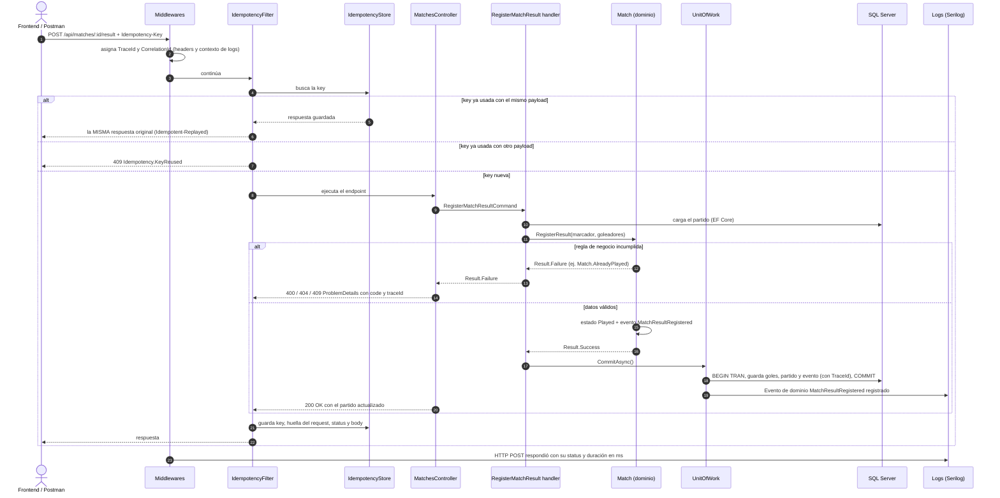
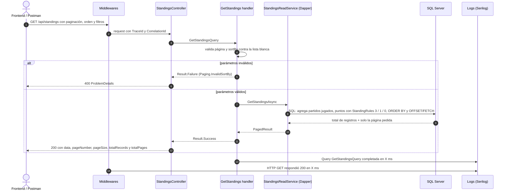

# Arquitectura — Mundialito de Fútbol Corporativo

Diagramas en [Mermaid](https://mermaid.js.org/): GitHub los dibuja automáticamente al abrir este archivo.

| Elemento pedido (§13) | Dónde se ve |
|---|---|
| Capas | Diagramas 1 y 2 |
| CQRS · EF Core (write) · Dapper (read) | Diagramas 2, 3 y 4 |
| UnitOfWork | Diagramas 2 y 3 |
| Idempotency storage | Diagramas 2 y 3 |
| Eventos | Diagramas 2 y 3 |
| Logs · Trace flow | Diagramas 2, 3, 4 y sección 5 |
| Frontend · Docker | Diagrama 2 |

---

## 1. Capas y dependencias (Clean Architecture)

Las dependencias apuntan siempre hacia el dominio. Domain no conoce a nadie; Infrastructure implementa los contratos que define Application; Api solo orquesta.

---

## 2. Vista general: componentes, CQRS y Docker

- **CQRS:** los *commands* escriben con **EF Core** y siempre guardan con el **UnitOfWork**; las *queries* leen **solo con Dapper**, paginando en SQL.
- **Docker:** `docker compose up` levanta los 3 contenedores. La API espera a que SQL Server esté *healthy*, aplica las migraciones y carga el seed si la base está vacía.

---

## 3. Flujo de escritura: registrar un resultado

`POST /api/matches/:id/result` con el header `Idempotency-Key`.

Si el `SaveChanges` falla, la transacción hace **rollback**: no se guardan ni los cambios ni los eventos.

---

## 4. Flujo de lectura: tabla de posiciones

`GET /api/standings?pageNumber=1&pageSize=10&sortBy=points&sortDirection=desc`

---

## 5. Trazabilidad (trace flow)

1. Cada request recibe un **TraceId** (W3C, del `Activity` de .NET) y un **CorrelationId** (el header `X-Correlation-Id` del cliente o, si no viene, el mismo TraceId).
2. Ambos se devuelven en los headers `X-Trace-Id` y `X-Correlation-Id`, y se agregan a **todas** las líneas de log del request.
3. Los **eventos de dominio** se guardan en la tabla `DomainEvents` con ese TraceId, en el mismo commit que los cambios.
4. Los errores responden con `traceId` en el ProblemDetails.

Con un solo TraceId se puede seguir un request completo: la respuesta HTTP, los logs del middleware y del handler, y los eventos guardados en la base.
